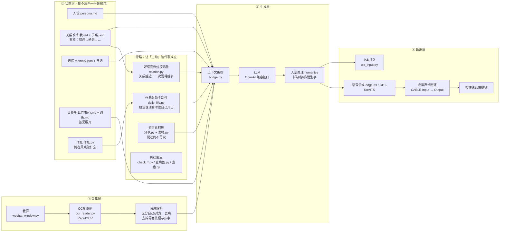

# 微信人设聊天机器人

> 一个**个人自用的微信 LLM Agent 研究项目**：在**不修改、不逆向微信客户端**的前提下，
> 用 Windows UI 自动化打通「收消息 → 理解 → 生成 → 发消息/发语音」的完整双向链路。
>
> 一份代码 + N 份角色数据包。仓库里的示例角色 `角色\白佰岚\` 是**原创角色**。

**技术栈**：Python 3.10–3.12 · UI Automation · RapidOCR(ONNX) · OpenAI 兼容 LLM 接口 · edge-tts · GPT-SoVITS · 虚拟声卡音频回环

---

## 目录

- [它解决了什么约束](#它解决了什么约束)
- [架构](#架构)
- [三个真正的技术难点](#三个真正的技术难点)
- [多角色隔离：一份代码 + N 份数据包](#多角色隔离一份代码--n-份数据包)
- [自检体系](#自检体系)
- [快速开始](#快速开始)
- [目录结构](#目录结构)
- [配置](#配置)
- [已知限制与可改进项](#已知限制与可改进项)
- [合规边界](#合规边界)
- [License](#license)

---

## 它解决了什么约束

做这个项目的人有个很具体的需求：**让一个有人设的角色，在真实的微信会话里长期稳定地陪人说话。**

但这件事的入口是关着的：

| 途径 | 为什么不能用 |
|---|---|
| 微信官方 API | 个人号没有 |
| Hook / 注入 DLL | 需要逆向客户端，账号封禁风险高 |
| 第三方协议号 / iPad 协议 | 把账号密码交给外部服务，且明确违反用户协议 |
| 网页版自动化 | 网页版早已下线 |

所以只剩一条路：**当作一个人在用微信**——截屏看消息、模拟键鼠打字、模拟快捷键发语音。
代价很明确：延迟、OCR 准确率、焦点抢占。这个仓库里绝大多数代码，就是在处理这三个代价。

---

## 架构



**一句话概括**：采集层负责"看见"，状态层负责"记得"，生成层负责"想说"，输出层负责"说出去"，
旁路负责"她为什么会在你没说话的时候开口"。每一层都有独立的自检脚本。

---

## 三个真正的技术难点

### 1. 为什么用 OCR 截图而不是 Hook —— 以及怎么把延迟压下来

**选它**：合规、零封号风险、不依赖任何第三方服务。**代价**：慢、会认错、抢焦点。

实际处理过的坑（都在 [程序/README.md](程序/README.md) 里有完整复盘）：

- **只截会话区，不全屏**：全屏 OCR 会把桌面其他窗口的字一起认进来。`wechat_window.py` 先定位窗口矩形，再按比例裁出消息区。
- **区分「对方发的」和「界面上的字」**：时间戳、系统提示、输入框占位符都会被 OCR 当成消息。靠气泡位置 + 图形特征 + 文案黑名单三层过滤。
- **自己发出去的消息也会被截到**：必须回读确认（发完再 OCR 一次，比对是否真的出现了），否则会陷入"自己回复自己"。
- **长消息会被截断**：微信气泡有最大高度，超长文本在截屏里是不完整的。这个坑导致过"我发了一句长消息她不理"——实际上是她**只看到了后半句**。

### 2. 虚拟声卡音频回环 —— 怎么让程序"按住说话"

微信语音消息是按住快捷键录制的，程序没法直接从内存喂音频。做法是：

```
文本 → TTS 生成 wav → 播放到 CABLE Input（虚拟声卡）
                              ↓ 声卡内部回环
                    微信从 CABLE Output 录音
                              ↓
              程序模拟「按住说话」快捷键的 keydown / keyup
```

关键在于**时序**：必须等音频真正开始播放再按下、音频放完之前不能松开，否则录到的是半截。
`check_voice.py` 和 `声卡回环测试.py` 就是用来把这条链路的每一段单独验通的
（录一段音看波形振幅，接近 0 就说明链路断了）。

### 3. 让输出"像人"：拆句、节奏、以及别一次说完

LLM 默认输出是一整段话。真人微信不是这么发的。

- **按语义拆句**，逐条发送，条与条之间加**随机的短停顿**（读起来像在打字）
- **关系档位决定一次说几条**：初遇档只发一条，熟络之后才会连发
- **素材去重**：`分享.py` 维护一个"已经说过的"集合，同一件事不会第二次主动提起
- **作息驱动**：她几点睡、几点上课、什么时候在图书馆，都由角色的 `作息.py` 定义，不在这个时间段就不该说话

---

## 多角色隔离：一份代码 + N 份数据包

这是整个项目里我自己最满意的设计。

**问题**：最早每个模块开头都写着同一行

```python
ROOT = Path(__file__).resolve().parent   # 「脚本自己所在的那个文件夹」
```

于是「一个进程 = 一个角色」被写死在了 **19 个文件、170 处引用**里。想换角色就得改 170 处。

**解法**：把 `ROOT` 换成一个**惰性路径代理**（`角色.py` 里的 `CharRoot`）：

```python
from 角色 import ROOT
# 下面这些旧写法一行都不用改，但它们全落到「当前角色」身上了
p = ROOT / "persona.md"
```

你写下 `ROOT / "persona.md"` 的那一刻，它才去问"现在是谁"，然后给出 `角色\<当前>\persona.md`。

由此带来三个性质：

1. **换人只改一个指针**（`角色\当前.json`），下一次读 `ROOT` 就是新角色，不用重启进程
2. **别人的人设根本不会被读进内存**——不是"让模型忽略她"，是那份文件压根没被打开过。
   这是最省 token 的一刀，也是隔离最彻底的一刀
3. `大事.py` / `素材.py` / `日计划.py` 这类"数据 + 一小段代码"的模块走 `charmod()` 按**文件路径**加载，
   并且**带角色名做缓存 key**——否则 Python 会把模块缓存住，换人还给你旧的那份

> 对比一下：酒馆（SillyTavern）的群聊是把所有角色卡塞进同一个上下文，靠 `{{char}}` 变量让模型区分谁在说话。
> 那是**提示词层面**的隔离，模型一迷糊就串。这里是**文件层面**的隔离。

---

## 自检体系

这是我愿意把这个项目拿出来讲的主要原因：**它自己会验自己。**

| 脚本 | 作用 |
|---|---|
| `程序\check_audio.py` | 声卡设备是否就位、虚拟声卡链路是否通 |
| `程序\check_llm.py` | LLM 接口连通性、模型名是否有效、返回是否为 JSON |
| `程序\check_send.py` | 消息注入通道是否可用 |
| `程序\check_voice.py` | TTS → 声卡 → 录音 全链路 |
| `程序\check_wechat.py` | 微信窗口定位、会话能否被正确截取 |
| `程序\check_console.py` | 本地控制台页面与后端接口 |
| `程序\声卡回环测试.py` | 单独验证声卡回环（录一段看波形） |
| `程序\查角色.py` | **单角色体检**：11 段、只读，检查一个角色数据包是否完整合规 |
| `程序\查错.py` | **全量回归**：一个角色要跑过近 800 条断言，`--who <角色>` 可指定角色 |

跑一遍：

```bash
程序\.venv\Scripts\python.exe 程序\查角色.py 白佰岚
程序\.venv\Scripts\python.exe 程序\查错.py --who 白佰岚
```

示例角色当前状态：

```
查角色.py 白佰岚      →  失败 0 项、提醒 0 条（11 段全过）

查错.py  --who 白佰岚  →  失败 0 项
                          装完依赖 通过 761 项 / 刚 clone 没装 .venv 时 通过 644 项
                          （差的 117 项是 19 段靠 .venv 才跑的逻辑自测）
```

这些断言检查的东西相当细，比如：

- 人设里必须出现约定的固定格式串（否则状态机认不出来）
- 世界书的**核心卡字数上限**（每轮都要塞进上下文，超了就直接吃掉预算）
- 素材库里必须有**至少六成**条目能挂到主动话题上——否则就是"永久说不出口的废料"
- 作息表必须**无缝盖满一整天的分钟数**，不能有空洞
- 数据包里不许出现**别的角色的名字**（防串人设）
- 关键词不许是单字（引擎会静默忽略，等于白写）
- 体检脚本自己不许改动盘上的任何东西（只读）

---

## 快速开始

> ⚠ **只有 Windows**。核心链路依赖 Windows UI Automation 和 Windows 音频设备枚举。

### 1. 环境

Python **3.10 / 3.11 / 3.12**。**不要用 3.13+**——OCR 依赖 `rapidocr-onnxruntime` 目前不支持。

```bash
py -3.12 -m venv 程序\.venv
程序\.venv\Scripts\python.exe -m pip install -r 程序\requirements.txt
```

或者直接双击 `0-装依赖.bat`（它会自己挑 3.12 → 3.11 → 3.10 里能用的那个）。

### 2. 配置

打开 `角色\白佰岚\config.yaml`，至少改两处（文件里带 ★ 的）：

```yaml
target: 对方昵称                  # ★ 你大号在小号会话里的显示名
llm:
  base_url: "https://api.siliconflow.cn/v1"
  api_key: sk-在这里填你自己的Key   # ★ 换掉这个占位符
  model: deepseek-ai/DeepSeek-V4-Flash
```

任何 OpenAI 兼容接口都能用（DeepSeek / 通义 / 豆包 / 硅基流动 / 自建 vLLM 等）。

### 3. 先体检，再启动

```bash
程序\.venv\Scripts\python.exe 程序\check_llm.py     # 大脑通不通
程序\.venv\Scripts\python.exe 程序\check_wechat.py  # 微信找不找得到
程序\.venv\Scripts\python.exe 程序\查角色.py 白佰岚  # 数据包完不完整
```

全绿之后双击 `一键启动.bat`，或者 `7-控制台.bat` 打开本地控制台网页。

---

## 目录结构

```
├── 程序\                    ← 全部代码（27 个 .py）
│   ├── README.md            ★ 约 3400 行的开发踩坑复盘（最有信息量的一个文件）
│   ├── bridge.py            主循环：采集→编排→生成→输出
│   ├── ocr_reader.py        截图 OCR + 消息解析
│   ├── wechat_window.py     微信窗口定位与裁剪
│   ├── wx_input.py          文本注入（模拟键鼠）
│   ├── relation.py          好感度 / 关系档位
│   ├── daily_life.py        作息驱动的主动性
│   ├── journal.py           日记与记忆总结
│   ├── 世界书.py             世界观卡片的加载与按需展开
│   ├── 分享.py              主动分享的话题与去重
│   ├── 约定.py              格式约定（人设/世界书必须长什么样）
│   ├── 角色.py              ★ 多角色那一层（CharRoot 惰性路径代理）
│   ├── 控制台.py            本地网页控制台
│   ├── 查角色.py            ★ 单角色体检（只读）
│   ├── 查错.py              ★ 全量回归（近 800 条断言）
│   └── check_*.py           六个分项自检（声卡/大脑/发送/语音/微信/控制台）
│
├── 角色\                    ← 数据包，一个子目录 = 一个角色
│   ├── 当前.json            指针：现在是哪一个
│   └── 白佰岚\              ← 示例角色（**原创**）
│       ├── persona.md       人设正篇
│       ├── 你和我.md         关系设定：五档结构
│       ├── 世界\            核心.md（每轮都带）+ 词条.md（按需展开）
│       ├── config.yaml      该角色的全部配置
│       ├── 关系.json         关系状态（自动维护）
│       ├── memory.json      记忆（自动维护）
│       ├── 素材.py          分享素材池
│       ├── 大事.py          可触发的剧情事件
│       ├── 日计划.py        今天去哪儿的可替换窗口
│       └── 作息.py          她几点在做什么
│
├── docs\
│   ├── 好感度系统设计.md      关系档位那套的设计文档
│   └── 脱敏扫描报告.md        发布前的扫描记录
│
├── 0-装依赖.bat … 8-看记忆.bat    双击即用的启动/自检入口
├── 一键启动.bat
├── 使用说明.txt             面向使用者的中文手册（GBK）
├── requirements.txt
└── LICENSE
```

---

## 配置

`角色\<角色名>\config.yaml` 是**每个角色一份**的，顶层分组：

| 分组 | 管什么 |
|---|---|
| `target` | 盯着哪个微信会话 |
| `llm` / `vision` | 文本模型 / 读图模型（读图可独立配） |
| `sender` | 消息发送服务地址（默认 `127.0.0.1:9877`） |
| `voice` | TTS：edge-tts 云端 或 GPT-SoVITS 本地（默认 `http://127.0.0.1:9880`） |
| `behavior` / `humanize` | 拆句、停顿、错别字、打字节奏 |
| `relation` / `confess` | 关系档位与表白线 |
| `life` / `proactive` / `story` | 作息、主动性、剧情触发 |
| `memory` / `journal` | 记忆与日记的容量与总结策略 |
| `share` / `sticker` | 主动分享与表情包 |
| `world` | 世界书：核心卡 + 词条 + **共享目录** |

> ⚠ **`world.share_dir` 是最容易踩的一个坑。**
> 它决定"共享词条"去哪找。写 `"共享"` = 只在该角色包内的 `世界\共享\` 找；
> 写 `"世界/共享"` = 去**项目根**找公共卡。
> 示例角色故意写成前者——她的世界观是完全独立的，物理上不该读到任何别人的设定。

---

## 已知限制与可改进项

主动写缺点：

1. **只能 Windows**。UI Automation 和音频设备枚举都是 Windows 专有。
2. **OCR 天生不可靠**。遇到图片消息、表情包、被折叠的长文本会失败。现在的兜底策略是"读不出来就不回应"，而不是猜。
3. **抢焦点**。注入键鼠期间用户不能操作微信，否则会打错到别处。没有做前台检测。
4. **单进程 = 单会话**。同时只能盯一个聊天窗口。
5. **`查错.py` 5641 行、`bridge.py` 4670 行**，是真实工作量，但也是真实的"该拆了"。
   拆成 `core/` + `checks/` 是下一步。
6. **没有单元测试框架**。自检脚本是命令式的断言，不是 pytest。可测性不如标准做法。
7. **依赖真实屏幕分辨率**。改分辨率或缩放比之后，窗口相关参数要重新标定。

---

## 合规边界

- 这是**个人自用**的研究项目，**没有**修改、**没有**逆向微信客户端，**没有**使用任何第三方协议服务。
- **未用于**群发、营销或任何商业用途。没有对外提供服务。
- 项目通过 Windows UI 自动化实现——**它的前提就是"和一个真实用户操作客户端没有区别"**。
- 示例角色 `角色\白佰岚\` 及其世界观（雾屿 / 幽潮 / 静默署 / 引渡人）为**本项目原创**，
  与任何现有作品的设定无关。

**请不要**把本项目用于骚扰、批量加好友、营销群发或其他违反《微信软件许可及服务协议》的场景。

---

## License

[MIT](LICENSE)
