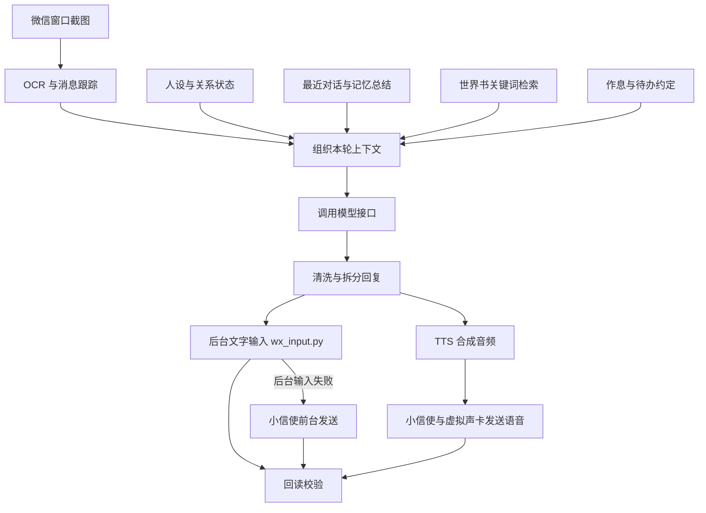

# 微信人设聊天机器人

我想做的是一个能在微信里长期聊天的角色：有自己的背景和作息，能记住聊过的事，也能在合适的时候主动说话。这个项目就是从这个想法开始的，仓库里保留了我的原创角色白佰岚，作为完整的使用示例。

程序通过 Windows 窗口操作和 OCR 读取消息，调用 OpenAI 兼容的模型接口生成回复，再发送文字、表情或语音。微信接入使用的是桌面自动化；API 用于调用模型和本地发送服务。

目前主要精力花在消息识别、发送确认、角色状态和上下文管理上。

## 目前能做什么

- 读取微信会话中的消息，过滤部分界面文字，区分自己和对方的消息。
- 根据角色设定、关系状态、最近对话和记忆总结组织提示词。
- 按关键词检索世界书词条，限制每轮选入的条数和正文字符数。
- 按配置拆分回复、调整发送间隔，并发送文字、表情或合成语音。
- 根据作息、关系档位和待办约定决定是否主动发消息。
- 在本地网页里修改配置、查看角色状态、检查词条命中情况和切换角色。

代码主要使用 Python，涉及 Windows UI Automation、RapidOCR、OpenCV、requests、edge-tts，以及可选的 GPT-SoVITS 和虚拟声卡。

## 消息是怎么走的



主流程在 [程序/bridge.py](程序/bridge.py)。文字优先走 `wx_input.py` 的后台输入，失败后尝试前台发送；语音和表情发送也依赖外部的小信使服务。当前主循环在启动时会检查这个服务，因此即使只用文字，也需要先把服务启动。

### 收消息和发送确认

截图只覆盖微信窗口，再从中定位聊天区。OCR 结果需要经过位置判断和文字过滤，才能交给消息跟踪器；时间戳、按钮文字和自己的回复，都不能直接当成新消息。

后台文字输入会先核对当前会话，再检查文字是否进入输入框。前台发送后也会尝试回读聊天区，判断消息气泡是否出现。连续发送失败时会暂停一段时间，避免一直重试。

这些检查仍然依赖截图和 OCR。回读不到不一定代表没有发出，回读结果也可能有误，因此目前不能保证消息恰好发送一次。长文本、遮挡面板和界面变化都是需要继续处理的情况。

相关代码：[ocr_reader.py](程序/ocr_reader.py)、[wechat_window.py](程序/wechat_window.py)、[wx_input.py](程序/wx_input.py)。

### 人设、记忆和世界书

白佰岚的设定不只是展示用的文案。她的背景、作息和关系档位会参与上下文组织，也影响主动消息和回复长度。

最近对话保存在角色目录的 `memory.json`，较长的聊天由 [journal.py](程序/journal.py) 定期总结。总结结果会参与后续提示词，但仍可能遗漏信息或记错，不能当作完整的聊天记录。

世界书分为每轮加载的核心设定和按需选入的词条。[世界书.py](程序/世界书.py) 根据关键词、上下文权重和过滤条件给词条评分，再按条数、正文字符预算和互斥组选择内容。这里使用的是关键词检索，目前没有使用 Embedding 或向量数据库。字符预算也不等于实际 token 数，核心设定、固定词条和提示词包装还会额外占用上下文。

角色设定可以直接查看：[人设](角色/白佰岚/persona.md)、[世界核心](角色/白佰岚/世界/核心.md)、[世界词条](角色/白佰岚/世界/词条.md)。

### 角色切换

每个角色有独立的配置、设定和运行数据目录。`角色.py` 中的 `ROOT` 是一个路径代理，在拼接路径时指向当前角色；角色专属的 Python 数据模块则按角色名缓存。

不过，`ROOT / "persona.md"` 返回的是当时的实际路径，已经保存到对象里的路径不会自动变化。因此切换时，主循环还会重建 `Brain`、发送器和其他相关对象，并清理部分缓存。仅修改 `角色/当前.json`，并不足以让所有已创建的对象立即切换。

这是一种单进程内的角色数据组织方式，不是多租户权限隔离。仓库目前只附带白佰岚这一份示例数据包。

## 运行前需要准备什么

当前实现面向 Windows，建议先使用 Python 3.10–3.12，减少现有 OCR 依赖的兼容问题。仓库没有提供其他 Python 版本的验证结果。

除了 Python 依赖，还需要：

| 项目 | 用途与要求 |
|---|---|
| Windows 微信客户端 | 已登录，能正常打开目标会话。窗口不要最小化到托盘；界面版本、布局和缩放变化可能影响识别。 |
| 模型接口 | 配置可用的 `base_url`、API Key 和模型名。代码按 OpenAI 风格的 `chat/completions` 格式调用，具体兼容性需要自检。 |
| WeeMessenger（小信使） | 默认连接 `127.0.0.1:9877`。适配过的源码已放在 `小信使/`，保留原作者的 MIT 许可证；首次使用仍需安装 Python 依赖。 |
| 语音环境（可选） | 使用语音时还需要虚拟声卡、正确的录音设备和微信语音快捷键。默认 TTS 为 edge-tts；使用 GPT-SoVITS 时需要另行部署服务和配置模型。 |

仓库已包含主程序和发送组件的源码。首次使用请先安装 Python、执行依赖安装并填写模型配置，再登录微信。语音需要的虚拟声卡驱动、GPT-SoVITS 服务和模型仍需按自己的环境准备；这些步骤不会由“一键启动”自动完成。

## 安装和启动

以下命令在 Windows PowerShell 中执行，当前目录为仓库根目录。

### 1. 安装 Python 依赖

```powershell
py -3.12 -m venv 程序/.venv
& ./程序/.venv/Scripts/python.exe -m pip install -r ./程序/requirements.txt
```

上面的命令只安装主程序依赖。完整运行推荐使用 `0-装依赖.bat`，它会优先寻找 Python 3.12、3.11、3.10，并为主程序和小信使分别安装依赖。手动安装小信使的命令见[组件说明](小信使/README.md)。

### 2. 确认角色并填写配置

```powershell
& ./程序/.venv/Scripts/python.exe ./程序/角色.py --who
```

编辑 `角色/白佰岚/config.yaml`，至少核对这些字段：

```yaml
target: "对方昵称"  # 机器人登录账号中，目标会话的显示名
llm:
  base_url: "https://api.siliconflow.cn/v1"
  api_key: "YOUR-KEY-HERE"
  model: "替换为服务商实际支持的模型名"
```

这段只是字段示意，请修改原配置中的对应项，不要覆盖整份配置。`base_url` 也可以换成其他兼容服务的地址；当前代码会在地址末尾缺少 `/v1` 时自动补上，再拼接 `/chat/completions`，需要留意它是否符合服务商的路径。

首次验证可以先把原配置中的 `voice.enabled` 改为 `false`，只检查文字链路。准备使用语音时再开启，并检查音频设备、发送快捷键和 TTS 配置。

API Key 填在本地配置中；这份示例配置受 Git 跟踪，提交前请检查差异，避免把真实 Key 一起提交。

### 3. 分别检查模型和微信识别

```powershell
# 会实际请求配置的模型接口，可能产生调用费用
& ./程序/.venv/Scripts/python.exe ./程序/check_llm.py

# 抓取微信画面，打印识别到的消息；不要求填写模型 Key
& ./程序/.venv/Scripts/python.exe ./程序/bridge.py dump
```

第二条通过后，还应自己核对识别出的会话、消息内容和发送方是否正确。

后台文字输入可以先用不发送消息的模式检查：

```powershell
& ./程序/.venv/Scripts/python.exe ./程序/check_send.py --dry
```

### 4. 启动聊天主循环

完整安装依赖后，可以直接使用 `一键启动.bat`，同时启动小信使和聊天主循环。如果需要分别排查，也可以先在一个终端启动发送服务：

```powershell
& ./小信使/venv/Scripts/python.exe ./小信使/main.py
```

确认其 HTTP 地址与配置中的 `sender.host`、`sender.port` 一致，再在另一个终端启动主程序：

```powershell
& ./程序/.venv/Scripts/python.exe ./程序/bridge.py run
```

主循环启动后可能发送角色开场白，后续也可能根据配置主动发消息；请先选好测试会话。停止主循环使用 `Ctrl+C`。如果使用一键启动，发送服务在另一个窗口运行，结束使用时也要关闭该窗口。

### 5. 打开控制台（可选）

```powershell
& ./程序/.venv/Scripts/python.exe ./程序/控制台.py
```

也可以使用 `7-控制台.bat`。控制台默认尝试监听 `127.0.0.1:7788`，实际地址以终端输出为准。它是独立进程，**打开控制台不等于启动聊天主循环**。

## 配置里几个容易混淆的地方

- `sender.background` 控制是否尝试后台文字输入。后台通道只能处理当前已打开的目标会话；切换会话、前台兜底和语音操作仍可能激活微信。
- `voice.engine` 选择 `edge` 或 `local`。`local` 对应另行部署的 GPT-SoVITS 服务，不能仅通过安装本仓库依赖启用。
- `memory` 管近期对话，`journal` 管定期总结，两者不是同一份数据。
- `world.share_dir` 为相对路径时，先相对角色的世界书目录查找，找不到再相对项目根目录查找；也支持绝对路径。示例值 `共享` 通常对应 `角色/白佰岚/世界/共享/`。写成 `世界/共享` 并不意味着一定读项目根目录，如果角色内的候选目录存在，仍会优先使用它。

完整字段和注释见 [示例配置](角色/白佰岚/config.yaml)。

## 检查与排错

原有检查主要使用自定义脚本，既包含文件、格式和源码检查，也有模拟输入、模拟响应及实际环境检查，不能把通过条目数直接当成测试覆盖率。`tests/` 另有基于标准库 unittest 的发送服务接口测试。

接口测试只启动临时本机 HTTP 服务、验证指令入队，不加载微信发送器，也不调用模型：

```powershell
& ./程序/.venv/Scripts/python.exe -m unittest discover -s tests -p "test_sender_service.py" -v
```

| 脚本 | 主要用途 |
|---|---|
| `程序/check_llm.py` | 检查模型接口调用和返回内容，会请求外部服务。 |
| `程序/check_wechat.py` | 检查微信窗口定位与截图。 |
| `程序/check_send.py` | 检查后台文字输入；默认会发送测试消息，`--dry` 不发送。 |
| `程序/check_audio.py` | 检查音频设备配置。 |
| `程序/check_voice.py` | 默认检查语音环境；`--probe` 操作语音快捷键，`--send` 会实际发送测试语音。 |
| `程序/声卡回环测试.py` | 单独检查音频回环。 |
| `程序/查角色.py` | 检查角色包文件、格式、模块接口与上下文组织等。 |
| `程序/查错.py` | 汇总回归检查，可用 `--who` 指定角色。部分检查依赖环境、角色或系统日期。 |
| `程序/check_console.py` | 用于在沙箱副本里启动控制台并检查接口；有 Node.js 时还会检查页面渲染逻辑。 |

角色检查和回归检查的入口：

```powershell
& ./程序/.venv/Scripts/python.exe ./程序/查角色.py 白佰岚
& ./程序/.venv/Scripts/python.exe ./程序/查错.py --who 白佰岚
```

检查结果以实际输出为准。跳过的环境检查不代表通过，某个检查通过也不代表真实微信中的整条链路已经验证。尤其不要把所有 `check_*.py` 都当作没有副作用的静态检查。

开发过程中的问题和排查记录放在 [程序/README.md](程序/README.md)。这份文档保留了旧角色名和历史方案，当前行为请结合代码确认。

## 目录结构

```text
程序/
  bridge.py          主循环、上下文组织、模型调用与发送调度
  ocr_reader.py      截图、OCR、消息解析与跟踪
  wechat_window.py   微信窗口定位与激活
  wx_input.py        后台文字输入与回读检查
  journal.py         记忆总结
  世界书.py          词条解析与关键词检索
  角色.py            角色路径、切换与数据模块加载
  relation.py        关系状态
  daily_life.py      作息与主动消息相关逻辑
  控制台.py          本地网页与接口
  requirements.txt   Python 依赖
  check_*.py         环境和功能检查
  查角色.py / 查错.py 角色包与回归检查
角色/
  当前.json          当前角色指针
  白佰岚/            原创示例角色的配置、设定与初始状态
    世界/             核心设定、词条和共享词条
    作息.py / 素材.py / 大事.py / 日计划.py
    persona.md / 你和我.md / 开场.md
    config.yaml / memory.json / 关系.json
docs/                设计说明与发布前的脱敏记录
小信使/              WeeMessenger 适配副本，保留独立许可证和组件说明
tests/               不操作微信的发送服务接口测试
一键启动.bat         按约定目录启动小信使和聊天主循环
0-装依赖.bat 等      安装、配置、诊断和控制台入口
使用说明.txt          操作说明
LICENSE
```

## 已知限制

- 目前依赖 Windows 桌面环境，一个主循环围绕一个目标会话运行。
- 微信版本、缩放、布局、侧栏以及被折叠的长消息都可能影响识别。后台输入和回读检查也不能消除这些影响。
- 图片内容理解需要另配可用的视觉模型，OCR 本身不能理解图片；语音和表情链路也各有环境依赖。
- 前台兜底、切换会话和发送语音可能打断用户操作，使用时仍需留意微信状态。
- 记忆总结、角色一致性和世界书命中仍缺少统一的量化评估。
- `bridge.py`、`控制台.py` 和 `查错.py` 较大，业务逻辑、界面与检查代码还需要逐步拆分。
- 依赖没有锁定到一套可复现版本；完整微信收发和语音还需要结合本机客户端与音频环境验证。

## 使用范围

这是为个人角色聊天编写的项目，不是微信官方产品。主程序和随仓库提供的小信使使用桌面自动化接入，使用自动化不能据此保证账号没有风险。

请只在知情同意的会话中测试，不用于骚扰或批量营销。模型请求会把本轮上下文发到所配置的服务，分享日志、截图或配置前应检查其中的聊天内容和密钥。

## License

主项目使用 [MIT License](LICENSE)。`小信使/` 来自 [KilincocomilK/WeeMessenger](https://github.com/KilincocomilK/WeeMessenger)，原作者为 KoKoMilk，按其 [MIT License](小信使/LICENSE) 分发，包含本项目使用的本地适配，详见[组件说明](小信使/README.md)。模型服务、语音模型及驱动遵循各自的许可和使用要求。
